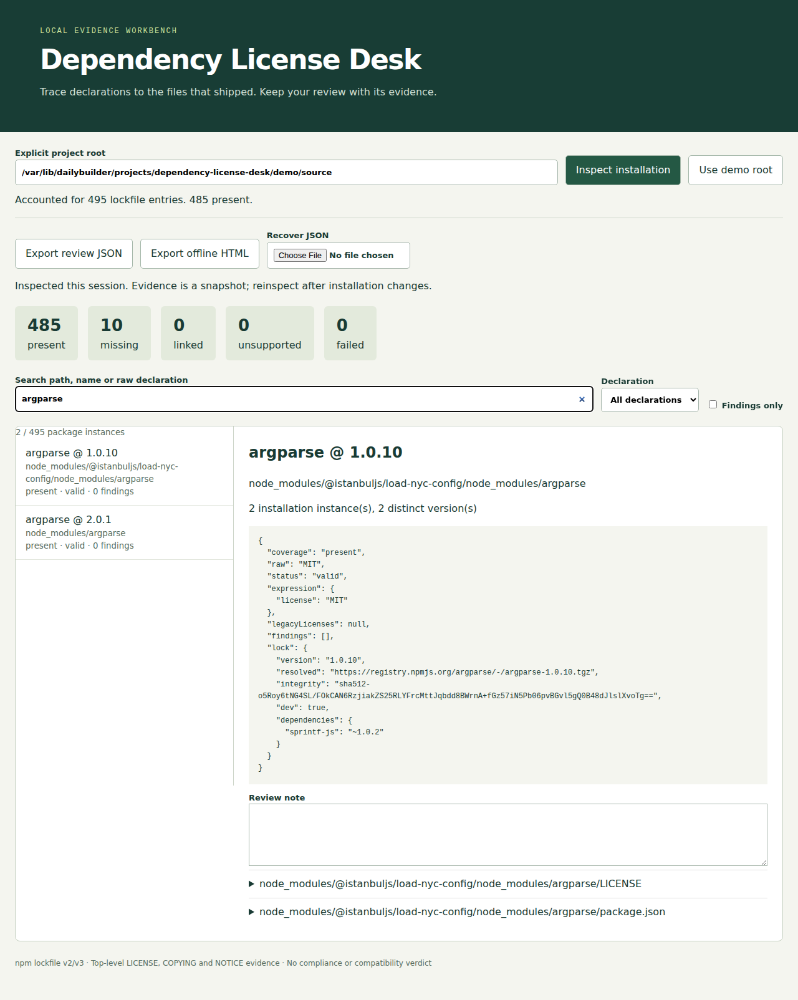

# Dependency License Desk

A local browser workbench for inspecting npm license declarations alongside the files shipped in an installation. Browse individual installation paths, review raw metadata and hashed evidence, save notes, and export a review that opens offline. It makes **no legal, compatibility, or compliance determination**.



## Launch

Requires **Linux with `/proc`, Node.js 22+ and npm**. From this directory:

```sh
npm ci --ignore-scripts --no-audit --no-fund --cache /tmp/license-desk-npm && npm start
```

Open **http://127.0.0.1:4173**. Enter an absolute project root containing an npm v2/v3 `package-lock.json` and an existing installation, then click **Inspect installation**. No installation, network request or package execution occurs during inspection. The selected root cannot traverse symbolic links. Stop concurrent installation/editing while inspecting; the report is a snapshot, not an atomic filesystem transaction.

To use the pinned real demo, first install its dependencies explicitly:

```sh
npm ci --prefix demo/source --ignore-scripts --no-audit --no-fund --cache /tmp/license-desk-npm
```

Then click **Use demo root**, followed by **Inspect installation**. This uses Commander.js v12.1.0 at commit `970ecae402b253de691e6a9066fea22f38fe7431`, including its development dependencies. Original manifest, lockfile and MIT license are preserved in `demo/source`; immutable source URLs, SHA-256 hashes, installation command and recorded tool versions are in [provenance](demo/provenance.json). Installed dependencies are intentionally untracked. You can also open the [sample HTML report](demo/reports/review.html) directly without a server or recover [sample JSON](demo/reports/review.json) in the app.

## Review and recovery

Search package paths, names or declarations; select a declaration status or **Findings only**. Select a package to see its installation instance, version, duplicate-instance/version counts, raw lock metadata, parsed declaration, discrepancies, package.json and top-level license evidence. Discovered files are evidence, not proof of the applicable terms.

Notes and filters save in browser local storage. Export JSON for a portable backup; browser storage may be cleared or run out of space. Recover JSON using the file picker. Reloaded and imported reviews are labeled **historical** until you reinspect the explicit root. Notes retain the original lockfile hash and package evidence fingerprint. Changed lockfiles, changed files, or missing package evidence trigger **STALE NOTE**; editing a note binds it to the current snapshot. Switching to a root with a different lock hash starts a separate review: export before switching if you want to keep it. Relocated projects with identical lock hashes retain notes. Notes for removed lock entries remain in JSON as historical records, with a visible count.

HTML export embeds metadata, evidence text, hashes and notes in a standalone, script-free document. It opens offline and always identifies itself as historical. JSON also preserves filters and structured data. Treat imported reviews as untrusted historical claims until you reinspect; hashes are change detectors, not signatures or authenticity proofs.

## Supported scope and limits

- npm lockfile **v2/v3 `packages` object**, including the root entry; no v1, shrinkwrap precedence resolution, Yarn or pnpm support. The v2 legacy `dependencies` graph is not interpreted. Packages not listed in this lockfile are outside coverage.
- Every listed entry receives `present`, `missing`, `linked`, `unsupported`, or `failed`. Present means readable manifest/evidence within scope, not complete licensing information. Optional omissions are reported without claiming why npm omitted them. Workspace source entries are inspected in-root; symlink entries are not followed. Aliases are flagged when installation name differs. Bundled entries are inspected only when listed in the lockfile.
- Only package.json and immediate filenames beginning LICENSE, LICENCE, COPYING or NOTICE (case-insensitive, optionally followed by `.`, `_` or `-`) are read. Nested license directories, README inference, `SEE LICENSE IN` target resolution and legal interpretation are outside this release. Missing files and read errors remain visible.
- `spdx-expression-parse@4.0.0` parses supported identifiers, AND/OR/WITH expressions, parentheses, plus suffixes and LicenseRef expressions. Operators must be uppercase. Raw values are never rewritten. `LicenseRef`, `UNLICENSED` and `SEE LICENSE IN …` are classified custom; absent and malformed values are separate. Legacy `licenses` is retained but not interpreted. Identifier support is bounded by the parser/list versions pinned in package-lock.json.
- Maximum 2,000 lock entries; 1 MiB per file; 16 MiB total evidence bytes; 2,000 directory entries per package; 32 candidate license files per package. Oversized lockfiles or package counts reject inspection; per-package errors mark coverage failed. Imports/requests cap at 32 MiB. No partial inventory is presented as fully inspected.
- Linux descriptor-relative, no-follow reads prevent symlink traversal, including symlinked ancestors. No mounted-filesystem isolation or protection against an attacker controlling the host is claimed. Source files are never written by inspection.
- Loopback-only server, exact Host/Origin checks, per-launch request token and inert text rendering. Use the printed `127.0.0.1` URL, not `localhost`. Set `PORT` if needed. No telemetry, CDN, hosted backend or automatic remote requests.

## Reproduce validation

```sh
npm test
npm run demo
npm run verify:demo
PLAYWRIGHT_BROWSERS_PATH=/tmp/license-desk-browsers npx playwright install chromium
PLAYWRIGHT_BROWSERS_PATH=/tmp/license-desk-browsers npm run test:browser
```

`demo` verifies the pinned source hashes before regenerating reports. `verify:demo` uses a separate Python 3 filesystem traversal and the established `license-checker-rseidelsohn@4.4.2` under matched installed scope. See [measured results](results/demo-verification.json). The browser check exercises real inspection, filtering, annotation, reload, JSON recovery, changed/missing evidence, export and offline reopening. Synthetic controls are explicitly isolated temporary fixtures; they are not the real-project evidence.

The recorded Linux installation has **495 lock entries: 485 present, 10 missing optional entries**. Independent traversal matched **941 evidence files**. The checker comparison covers 485 installed instances and 465 unique name/version keys, with 484 exact declaration matches. The one difference is `exit@0.1.2`: it declares legacy `licenses: [{type: "MIT", …}]`, has no `license` field, and ships LICENSE-MIT. The checker consumes legacy declarations; Desk intentionally retains them separately and reports the primary declaration absent. This is an extraction-policy difference, not a legal disagreement. Platform-dependent optional packages can produce different coverage on another host.

## Sources and existing work

This is an evidence-review workflow, not a novel license detector. The implementation was informed by [npm's lockfile format](https://docs.npmjs.com/cli/v11/configuring-npm/package-lock-json/), [SPDX expression syntax](https://spdx.github.io/spdx-spec/v2.3.1/SPDX-license-expressions/), and [license-checker-rseidelsohn](https://github.com/RSeidelsohn/license-checker-rseidelsohn). The latter supplies the independent extraction baseline; its normalization/inference policies differ from raw-field inspection. [Commander.js](https://github.com/tj/commander.js/tree/970ecae402b253de691e6a9066fea22f38fe7431) supplies the practical pinned input. Upstream license text and package metadata remain attributed in the evidence reports.
