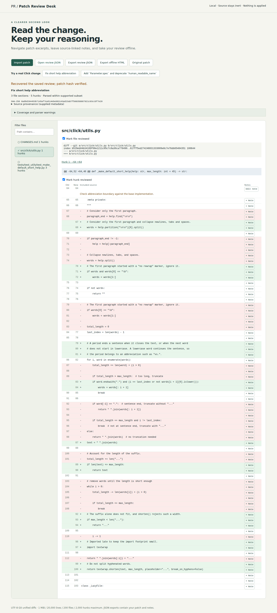

# Patch Review Desk

Inspect a local Git patch in your browser, attach line-specific review notes, recover your work after reload, and export a portable offline review. Imported code is displayed as text; patches are never applied and repositories are never modified.

## Launch

Install Node.js 22 or newer, then run:

```sh
./launch.sh
```

Open **http://127.0.0.1:4173**. No dependencies, account, or internet connection are required to use the application. The server binds to loopback. Set `PORT` to change the port; Ctrl-C stops it.

## Review a real change

1. Click **Fix short help abbreviation** to load a genuine Click patch, or import your own UTF-8 `.patch` file. The second demo reviews Click's `Parameter.spec` change. Both include full revision IDs, source URLs, BSD license evidence, and byte hashes in [demo/manifest.json](demo/manifest.json).
2. Filter the file list with `utils.py`, select the source file, and use the hunk links. Old/new numbers refer to their respective revisions; empty cells mean that side has no line. Only the patch's included context is available.
3. Click **+ Note** on a line, write a note, and save. Mark a hunk or file reviewed. These are independent personal checkboxes; they do not certify correctness or silently mark other hunks reviewed.
4. Reload to recover the last workspace from browser storage. The patch SHA-256 is checked on recovery. Storage failures are visible; export JSON as your durable backup. Importing a new patch replaces the current workspace, so export before switching if you need both reviews.
5. **Export review JSON** and open it in another browser with **Open review JSON**. The embedded original bytes are hash-checked and parsed anew; annotations use section/hunk/row identities, so repeated text does not merge notes.
6. **Export offline HTML**, then open the downloaded file with networking disabled. It includes all files (even filtered-out ones), old/new line references, notes, independent review status, provenance, warnings, and an embedded portable project. It has no scripts or external assets. **Original patch** downloads unchanged input bytes.

Sample reports: [short-help](results/short-help.html), [parameter-spec](results/parameter-spec.html), and [browser-created annotated review](results/workflow-review.html). The annotated sample note is a workflow example, not an upstream code review conclusion. Its [portable JSON](results/workflow-review.json) can be imported directly.



## Format and limits

See [format documentation](docs/format.md). Supported input is a bounded UTF-8 Git unified diff. Binary contents, combined diffs, submodule changes, malformed sections, and unknown text are explicitly flagged; they are not silently treated as fully understood. The raw input always remains in accepted project exports. Rejected oversized/invalid-UTF-8 imports leave the existing workspace intact.

Limits: 1 MiB patch bytes, 20,000 patch lines, 20,000 characters per line, 200 file sections, 2,000 hunks, 4,000 characters per note, and 8 MiB imported project JSON. Large imports near these limits may be slow. This is a patch viewer, not a full-source browser, merge tool, repository writer, or proof that changes are safe.

## Verification and reproduction

Application use needs no npm installation. Development browser checks use locked Playwright:

```sh
npm ci
npx playwright install chromium
npm test
npm run verify:demo
npm run test:browser
```

The browser test starts and stops its own loopback server on a free port. Set `PLAYWRIGHT_BROWSERS_PATH` consistently for browser installation and testing if using a custom cache. `verify:demo` validates every displayed source line and checks independent Git accounting without applying a patch. Both verification scripts refresh their evidence and sample exports in `results/`.

[Reproduction instructions](docs/reproduction.md) explain public fixture acquisition and the oracle. [Demo verification](results/demo-verification.json) and [browser execution evidence](results/browser-verification.json) record actual checks, not estimates. The synthetic controls in `tests/core.test.js` and `tests/browser.js` supplement the two real upstream changes. Browser execution currently covers Chromium only.

## Existing work

[Git's patch documentation](https://git-scm.com/docs/diff-format) defines extended headers, quoted paths, and the distinction between ordinary and combined diffs. [diff2html](https://github.com/rtfpessoa/diff2html) is an established viewer supporting line-by-line and side-by-side presentation. This application makes no novelty claim. Its scope is a dependency-free local review workflow with exact-byte portable recovery, explicit coverage warnings, and independently checked real examples.
