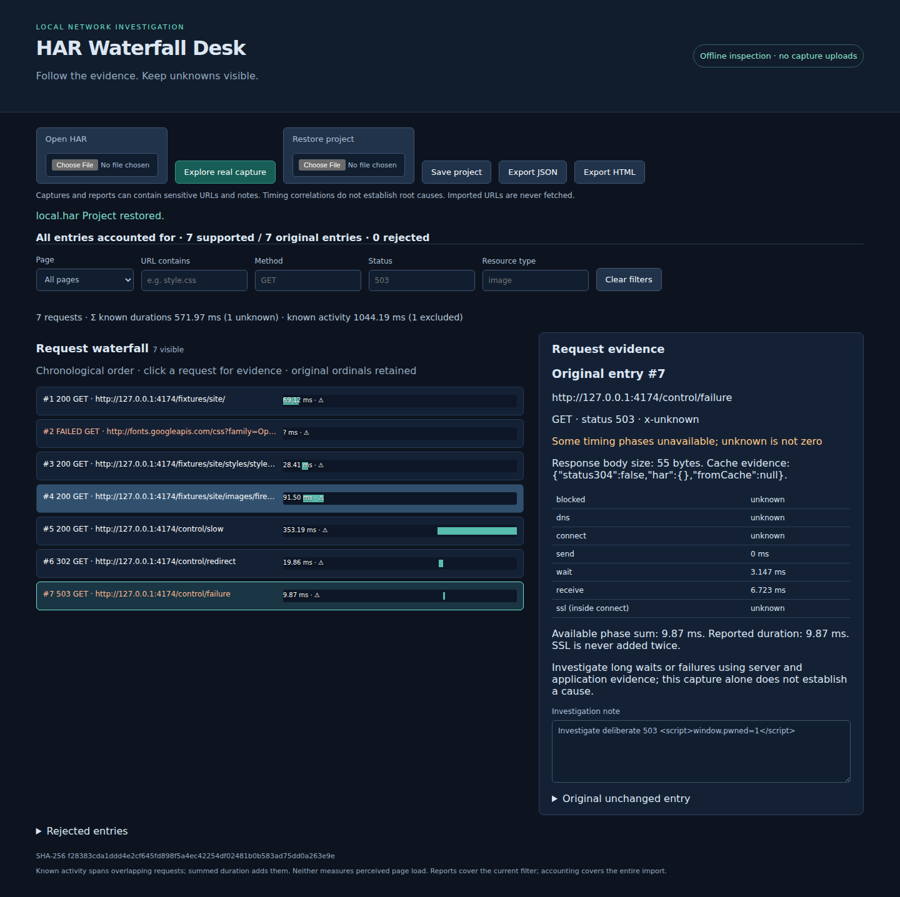

# HAR Waterfall Desk

Inspect browser network captures locally, investigate slow or failed requests, and save portable diagnostic reports. No capture upload or automatic request to captured URLs.

## Launch

With Node.js 20 or newer, run **`npm start`**, then open **http://127.0.0.1:4173**. No install or network is needed to run the application.

1. Click **Explore real capture** for the bundled Chromium recording of a locally served CC0 MDN website. `/control/*` requests deliberately introduce a delay, redirect and 503; these are not public-site observations. To inspect the actual public site recording, open `fixtures/public.har`.
2. Filter by page, URL substring, exact method/status, or resource type substring. Select a waterfall row to see original ordinal, timing uncertainty, cache evidence, redirect and raw entry.
3. Write a note. Reload and reopen the **same original HAR** to recover notes and filters. Save a project JSON for transfer between browsers; restore it and reconnect the exact HAR. SHA-256 mismatch prevents attaching notes to another capture.
4. Export HTML for a standalone readable report, or JSON for independent analysis. Reports include the current filtered scope and complete source accounting. Project exports contain notes/filters, not the capture; keep your original file.

Sample reports: [public HTML](results/public-report.html), [local HTML](results/local-report.html), [public JSON](results/public-report.json). Open the HTML files directly in a browser; they need no server or scripts.

## Evidence and reproduction

See [capture provenance](docs/captures.md), [data semantics and limits](docs/semantics.md), and [verification instructions](docs/verification.md). The real fixtures, independent Python oracle, browser workflow test and comparison with Jan Odvarko's HAR Viewer are included. This is a focused workbench, not a claim of a novel HAR viewer.

## Limits and privacy

HARs and reports can contain sensitive URLs, headers, cookies, request bodies and notes. Only share them deliberately. Browser storage is local to this origin and browser profile, can be cleared, and is not encrypted; export a project for durable recovery. The original HAR is read without modification and is never stored in localStorage. Run only on the loopback interface.

Up to 10 MiB and 10,000 entries per file; no truncation. Invalid entries remain explicitly accounted for as rejected, and the import stays visibly incomplete. HAR coverage is not the same as complete network coverage. Unknown timing/size values stay unknown; SSL is nested inside connect. Captured timestamps have millisecond resolution in this viewer. Summed durations and elapsed request activity are not user-perceived load time. Timing correlations cannot establish root causes. Missing or contradictory producer fields need corroboration.
